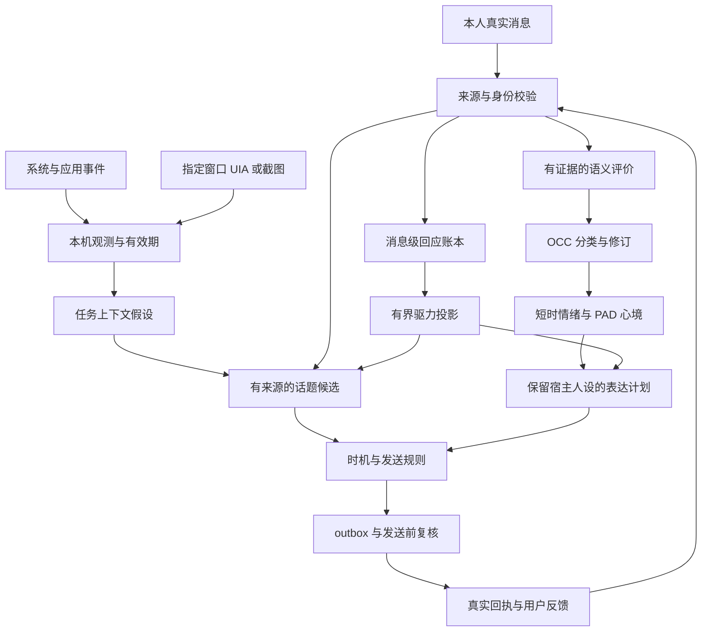

# 详细技术方案

日期：2026-10-26；设计版 1。本文的接口、表结构、开关和参数是**拟实施规格**，不能直接复制到当前 dev.6 配置。研究来源和证据强度见 [RESEARCH.md](RESEARCH.md)，实施工作包见 [任务书](IMPLEMENTATION_TASKBOOK.md)。

## 1. 目标与状态边界

同一 owner 的所有本人对话共享性格、关系、记忆、习惯与连续情感。当前宿主人设负责表达身份，不重新划分长期状态。电脑感知既包括系统事件，也包括指定应用内容理解。全程保留“哪里观察到、什么是解释、何时失效”的区别。

| 层 | 权威输入 | 可以影响 | 不直接决定 |
| --- | --- | --- | --- |
| 长期记忆 | 有证据的用户陈述、明确约定、更正 | 回忆与相关话题 | 人的真实心理状态 |
| 稳定性格 | 用户设置、版本化模板与明确习惯 | 表达倾向、调节方式 | 事实真伪、发送权限 |
| 关系 | 已校验互动事件及修复历史 | 熟悉、信任、亲近、戒备 | 未联系时自动扣分 |
| OCC 情绪 | 对具体事件／行为／对象的评价 | 当下反应与解释 | 用一个标签重写全部人格 |
| PAD 心境 | 有来源的情绪投影与慢速变化 | 语速感、热情、措辞与克制 | 用户本人是否抑郁、愤怒等诊断 |
| 驱力 | 时间、真实回应、有效的新内容、互动负荷 | 现有候选的排序和表达 | 自行创建事实、突破联系限制 |
| 电脑上下文 | 本机观测、所选应用 UI／图像 | 有时效的关心／分享候选 | 自动变成可迁移的用户偏好 |

## 2. 总体链路



已有 `ComputerEvents`、`OwnerIdentity`、`ExpressionRuntime`、调度器和 outbox 继续使用。新增模块挂在这些入口，不另建 QQ 入站消费者，不改 `app.asar`。

## 3. 电脑感知：两类能力、三个采集级别

| 级别 | 输入与实现候选 | 用户能获得什么 | 持久化与迁移 |
| --- | --- | --- | --- |
| L0 事件 | 空闲恢复、前台进程、通知状态、网卡、电量、资源、明确目录的变化 | 知道发生了哪类变化，结合既有话题选择是否关心 | 本机短期事件；不导出路径、应用轨迹 |
| L1 界面结构 | 指定应用的 UI Automation 控件、可见文本与状态 | 理解当前应用在做什么、是否有错误或完成提示 | 默认只保留短期摘要和证据索引；不自动写长期记忆 |
| L2 图像语义 | 用户选择的窗口截图，经区域筛选后本地 OCR／可选视觉模型 | 覆盖画布、游戏及 UIA 缺失的界面 | 原图默认内存处理；需要诊断保存时单独选择期限；默认不随记忆迁移 |

L1、L2 都是必交付能力；应用覆盖率分别报告，不能以 L0 完成代替内容理解。采集范围与是否允许发送给所选云模型分开设置；可选择仅本地 OCR、仅按需查看、或指定应用的有界自动分析。研究方案不等于现在已经开启这些采集。

### 3.1 统一观测契约

```typescript
interface Observation {
  id: string                 // 宿主生成，模型不可指定
  ownerId: string
  deviceId: string
  sessionGeneration: number  // 锁屏、切会话、停用后失效
  source: 'os' | 'uia' | 'window-image' | 'folder'
  observedAtMs: number
  expiresAtMs: number
  scopeRevision: string
  appIdentity?: string       // 可执行文件身份 + 启动实例，防止 PID 复用
  windowIdentity?: string
  facts: ObservedFact[]      // 原生字段／可见文本；标记来自 UIA、OCR 或模型
  unavailable?: string      // 不支持、拒绝访问、超时等
}
interface ContextHypothesis {
  observationIds: string[]
  interpretation: string
  confidence: number
  uncertainty: string[]
  expiresAtMs: number
}
```

UI 文本和网页内容始终是数据。模型不能借它更改采集范围、owner、来源 ID、联系对象、脚本参数或本机配置。OCR／VLM 摘要必须引用本次提供的观测范围；没有对应区域或控件依据的描述被拒收。

### 3.2 采集与内容理解流程

1. 范围判断：检查开关、设备会话、窗口与应用身份、当前范围修订。初次采样只建基线。
2. L0 采集不调用模型。通知状态查询与空闲检测独立；失败为未知，不当作“适合打扰”。
3. 对选定应用优先使用 UIA 的受限控件树；限定深度、节点数、总文本长度、超时和可见区域。密码控件不采集。UIA 无法覆盖的应用明确显示原因。
4. 需要图像时使用所选窗口捕获，检查能力、窗口关闭／尺寸改变／锁屏；不因窗口失效自动扩大成全屏。图像模型路线缺失时可降级到本地 OCR 或“无法理解图像”，不能伪装成已看懂。
5. 内容变化去重：控件摘要哈希或图像变化检测只决定是否值得分析，不能代替语义判断。应用切换后需要短暂稳定，避免每次 Alt-Tab 调用模型。
6. 先裁剪、排除已标记区域，再决定是否发往模型。自动遮罩不是绝对可靠的脱敏证明；无法确认范围时停在本地预览。模型路由、图像能力和估算成本可见。
7. 获得有依据的任务假设后形成候选。只看到 IDE 进程时可以记录“切到该应用”，不能声称“你编译又失败了”；看到明确错误文本才可说具体错误。
8. 停用、切换采集范围或会话失效时，递增 generation、停止监听、取消待分析任务、撤销相关待发候选；晚返回的模型结果不能重新写入。

首版不读取键入字符、剪贴板、摄像头、麦克风或整段浏览历史。指定目录事件沿用当前非递归规则；文件正文与目录变化是独立能力，不因为选择文件夹就读取全部文件。

### 3.3 本机助手实现取舍

当前每次 Windows 采样使用 PowerShell 加载固定 Win32 代码。继续作为兼容回退；实施 spike 比较常驻小型本机 helper 与当前方式的启动开销。helper 使用固定 JSON 输入输出、明确版本、超时与退出清理，不接收任意脚本，也不自动提权。UIA 和窗口捕获必须以实际 DSH 进程及目标应用验证后再选依赖，不预先编造宿主 API。

### 3.4 采集时机与参数初值

以下为 E／H 初值，不是研究常数：L0 保留当前 30 秒采样与 20 分钟空闲阈值作为基线；应用稳定窗口先比较 5／15／30 秒；自动视觉分析单应用至少间隔 5 分钟，每设备每日最多 6 次，手动按需分析另行显示预算。局部观测 TTL 先比较 5／15／60 分钟。实际选值由误触发、成本和用户评价决定。

临近低电量等时效事件和兴趣分享分别设置有效期，不用统一的一小时替代全部语义。内容已过期、窗口关闭或来源被撤销时，待发草稿必须重新核对或取消。

### 3.5 连续任务上下文

参考研究 S14–S16，增加短期任务线程，而不是“一个进程就是一项任务”。一个浏览器中可同时有多个目的，编辑器与浏览器也可能属于同一任务。线程记录来源、最近阶段假设、更新时间、置信度和到期时间；应用无意义切换不能直接推进为“任务完成”。

界面明确提示完成、错误或等待时形成带依据的阶段候选；缺少证据时保持未知。快速切换、误导页面和重新返回旧任务要保留历史限定，不能让最新一帧覆盖全部目标。任务线程属于本机短期上下文，不能因为反复看见就自动学习成稳定兴趣。自动主动建议、用户按需询问、被动线索显示分别统计。

## 4. 情境评价：先补语义，再增加类别

当前 `<evt>` 只支持十种关系事件，不足以表达完整 OCC 评价。拟新增 `observation-v2` 后台契约，与现有 QQ `<say>/<evt>` 兼容。旧输出继续可读；模型选择类别的自由文本不直接驱动状态。

```typescript
interface AppraisalV2 {
  focus: 'event' | 'action' | 'object'
  affectedParty?: 'self' | 'owner' | 'other'
  agency?: 'self' | 'owner' | 'other' | 'unknown'
  desirability?: number             // [-1, 1]，对主体的结果评价
  desirabilityForOther?: number
  likingForOther?: number
  deservingness?: number
  praiseworthiness?: number
  appealingness?: number
  likelihood?: number               // [0, 1]
  controllability?: number
  unexpectedness?: number
  relevance?: number
  prospect?: 'pending' | 'confirmed' | 'disconfirmed' | 'none'
  quote: string
  suppliedEvidenceRef?: string      // 只能选宿主提供的可见候选
  confidence: number
}
```

未知字段省略，不用 0 表示未知。宿主校验范围、组合、一致性、证据与主体；再绑定 sourceMessageId、owner、时间、目标和修订号。涉及自己过去的行为、承诺兑现或第三方背景时，只能选择宿主提供且有可见性的历史证据候选，不能自由填写 memory ID。

引用、小说、技术问题、纠错、玩笑和真实人际事件分开标记。低置信度评价保留为候选或轻微当轮提示，不自动形成长期恶意、占有欲或人格改变。电脑内容中的第三方话语不当作 owner 本人对角色说的话。

## 5. OCC、中文表达、PAD 与调节

### 5.1 分类与复合规则

确定性分类器处理五组分支：

- 对自身结果的正负评价：喜悦／痛苦。
- 对他人结果的评价：结合对他人的态度、结果对他人的意义和应得性，区分替人高兴、同情、怨羡、幸灾乐祸。
- 期待：希望／害怕，以及有前序期待证据的满足、担忧成真、释然、失望。没有期待记录时不推断“终于”“果然”。
- 行为归责：自己行为的自豪／羞愧、他人行为的赞许／责备。
- 对象吸引：喜欢／厌恶；以及同一因果事件中的喜悦＋自豪、痛苦＋羞愧、喜悦＋赞许、痛苦＋责备四种复合结果。

总计覆盖核对后的 22 个 OCC 类别。类别是软件评价，不是人的情绪诊断。复合成分可以同时展示，但一次原文对关系的变化仍只结算一次，不能“基础类别＋复合类别＋中文词”三次加减分。

中文显示层覆盖委屈、心酸、愧疚、吃味、被重视感、安心、失落。每项有必要情境和抑制条件；愧疚可为既有类别的中文表达，安心需要先前担忧，吃味需要具体关系威胁依据，不能由提到第三方自动产生。完整正反例见 [验收](ACCEPTANCE.md)。

### 5.2 时间与 PAD

短时成分按事件发生时间衰减：`I(t) = I0 * 2^(-elapsed / halfLife)`。每个成分存来源、强度、半衰期、参数版本和有效状态；时钟倒退不反向放大。

PAD 三轴统一使用项目内部 `[-1, 1]` 范围，明确这是工程归一化，不冒充原量表。按有效成分强度和置信度求加权目标，缺乏对应维度证据时保留不确定性；慢速心境采用对固定目标的指数平滑，并对连续变化采用确定的分段积分。必须满足相同事件下“多读几次不改变结果”。

类别到 PAD 的数值表需在 EM03 交付：每项记录方向、种子值、来源类型和可调范围。种子值一律标 E，不引用论文为精确坐标背书；“高唤醒／低控制”等不能硬套给所有同名情绪。若没有控制力依据，D 轴采用明确标识的先验或未知，不把 0 冒充实测。

迁移期保留当前五维 mood 兼容层。新投影提供情绪表达，旧字段可作兼容输出；同一事件不能同时走旧 mood 增量再叠加等效 PAD 增量。长期 relationship 暂沿用现有有界 reducer 和日上限，所有新分类不会自动产生额外关系扣分。

### 5.3 调节与表达

调节层根据当前任务、关系、性格和具体证据决定表达强度。可以有内部不满但继续准确完成技术任务，可以有牵挂但选择不打扰。状态不强迫所有角色使用固定撒娇、回怼或亲密台词。

默认 `enforce` 必须通过 `ExpressionPlan → renderPlan → 桌面／QQ／主动消息` 生效；只修改诊断用的 `renderStateBlock` 不算接入。普通回复不播报数值、内部类别或“我正在计算情绪”；控制台可以显示状态和原因。

现有 450 token 注入预算作为整体基线，新增情绪状态段目标不超过 150 个项目估算 token；由预算函数断言，不按中文字数估计。记忆与当前明确任务优先；按完整语义条目裁剪，不截掉限定条件。

## 6. 驱力：消息级事实与纯读取投影

拟建三个有界变量：联系需求、探索倾向、互动负荷。它们是软件调节量，不宣称身体饥饿、疲劳或人的生理需要。未解决的期待另存记录，不混成一种“缺爱值”。

联系需求的工程模型候选：

```text
D(t) = cap - (cap - D0) * exp(-max(0, t - t0) / tau)
收到一条新的本人消息后：D_after = (1 - rho) * D(t_message)
```

初始 `D0=0`；`tau=6 小时`、`rho=0.35` 仅作为敏感性测试中心，比较相邻参数。熟悉程度可影响 cap，但 cap 不能改变任何发送硬限制。配置变化需要版本化并夹紧旧值；计算使用已记录基线，而不是反复保存临时投影。

探索倾向只有在有来源的新话题、用户明确兴趣或实际获取的新条目后得到相关输入；互动负荷依据实际互动记录有界更新并随空闲降低。CPU 压力不是角色“疲劳”，键鼠输入不是用户“回复”。`recentIntimacyHit` 在没有明确的来源与产品定义前保持关闭，不拿任何普通聊天代替亲密互动。

### 6.1 必须满足的事件语义

1. 在**原始本人消息首次成功写入**的同一事务中记录一次回应事件，QQ 和桌面都有入口。
2. 不依赖该消息产生 0／1／多个评价。后台抽取重试、迟到或修订都不再结算回应。
3. 幂等键使用 owner＋稳定 sourceMessageId，不能只用毫秒时间；同一毫秒的两条真实消息分别算一次。
4. 助手、工具、内部任务、从界面读出的文本、未确认属于本人的 QQ 群消息不算主人回应。隔离试聊只写隔离主体。
5. 读取投影不写库、不改游标、无隐藏计时器；到同一时间多次读取，结果一致。
6. 静默只改变临时驱力与心境的计算，不降低 affection／trust／respect，不产生“你不理我”的惩罚。

## 7. 延迟评价、回放、纠正与删除

现有 `rebuildAffect` 只回放情感事件。新增驱力后必须合并“真实本人消息回应”与“有效评价”两个时间线，不能继续仅回放有情感标签的消息。

排序规则使用逻辑事件时间、稳定消息身份和事件类型优先级；原始消息的回应结算先于同消息的评价。实际处理时间单独记录。后台返回旧消息评价时，只增补该消息的有效评价，重建受影响的投影，不把它当成刚收到的新回应。重放和在线路径调用同一纯函数。

删除消息时撤销对应评价、驱力输入、期待、习惯、主动候选及派生引用，并重建当前状态；导入旧包也不能使这些内容复活。评价更正保留修订链，只启用一个生效版本。删除后允许软件状态随证据变化，不猜回已删除的内容。

旧数据迁移前创建一致性备份。旧评价只提供现有已知信息，不能凭旧标签伪造完整 OCC 向量；不完整的旧情绪保持 legacy 标记，旧消息可在有预算时重新评价。没有完整历史的快照保留来源不足诊断。

## 8. 存储与同步

建议新增表名为暂定名；按实施时最新迁移编号追加，目前最高为 `007`，不得修改已应用迁移。

| 数据 | 拟存储 | 同步规则 |
| --- | --- | --- |
| 主人回应事件 | `response_events`，源消息唯一键、事件时间、参数版本 | 同步后按源去重，不带本机 seq 当全局身份 |
| 语义评价 | `emotion_appraisals`，向量、证据、修订、有效状态 | 与原文及墓碑共同同步 |
| 情绪成分／心境 | `emotion_components`、版本化派生快照 | 事件为权威；校验版本后重建，不盲目叠加两个快照 |
| 明确期待 | `expectations`，建立／兑现／落空证据、修订 | 冲突保留并可解释，沉默不自动视作违约 |
| 本机观测／界面内容 | 独立本机缓存或明确排除的 `local.*` 记录 | 默认不进入 portable 与网盘，不进入用户原话表 |
| 采集范围与窗口授权 | 本机设置，范围修订与有效期 | 换机重新选择应用／窗口，不复制路径或权限 |

portable 格式增加版本和能力说明；旧版导入新格式需给出明确诊断。跨机合并后验证 owner、一致性、证据和墓碑。沿用主动设备归属；不能同时在两台机器按“想念”各发一条。完整参数版本和迁移回退路径进入导出说明。

本机观测过期后清理内容和派生引用。正在生成或排队的消息引用本机观测时，发送前复核有效期；不把“生成时曾有效”当成永久许可。

## 9. 主动联系与注意力

先检查硬闸门，再比较候选价值：owner／设备、开关、静默、正在对话、用户忙碌、未回复暂停、额度、最小间隔、目标有效、来源有效，以及可获得的系统通知状态。探针未知时自动闲聊保守等待，用户主动请求仍按正常会话处理。

候选评分可以增加联系需求、共同兴趣、当前心境和任务阶段因素，但这些只能影响**已有且有效的候选**。示意：`价值 = 相关性 + 新颖性 + 延续价值 + 有界驱力偏置 - 打断代价`；权重通过消融实验确定，不伪称是论文原公式。

应用切换或空闲返回只提供可能时机。全屏／演示／锁屏时不进行普通主动打断；到 TTL 仍无合适时机则取消或保留为控制台被动线索，不能因有界延迟论文而强行发送。明确提醒沿用其独立规则，但不扩大成所有系统事件的“紧急”豁免。

发送前再次检查来源、scopeRevision、generation、主人是否已回复及目标会话。沿用 outbox 的 accepted／rejected／unknown 区分；未知回执不能自动重发。反馈学习来自真实用户反馈，未回复只暂停，不解释成生气或拒绝关系。

## 10. 当轮响应与额外模型成本

默认后台评价：当前消息立即进入回应账本，保守的当轮线索可影响措辞，完整评价后续生效。它不承诺复杂 OCC 判断一定赶在当前回复之前完成。

另交付可选“先评价再回复”模式：每条消息最多一次独立的有界评价调用，等待上限、取消、超时和 usage 均有记录。超时回退到当前任务回复，后续评价仍按原消息结算。桌面和 QQ 都必须验证，不通过重写用户指定输出格式来强塞隐藏协议。

两种模式用同一模型与语料比较当前回复的适切性、可见首句延迟、总延迟、成本。不会为了新模型默认增加隐形串行调用。现有表达修复仍最多一次，防止评价、修复相互递归。

L0 和纯状态投影每次扫描模型调用为零；没有有效候选则零生成。UIA 本地读取不等于必定调用 LLM；视觉分析先检查图像能力和单独预算。成本表按真实 usage 分列前台、抽取、巩固、前置评价、视觉、表达修复和主动生成；未知 usage 标未知，不填零。

## 11. 控制台与可观测性

继续使用现有插件控制台，增加：采集级别与范围、所选窗口预览、采集／上传状态、最近事实与解释的区分、为何现在等待或联系、评价修订、驱力和 PAD 的来源解释、版本与能力诊断。调节范围用日常语言，技术字段留在诊断视图。

自检分别显示：当前配置、运行中模型声明、最近任务执行结果、历史终止任务。只在包的 bundle 默认插入插件、profile 没有覆盖行时，不应错误报告“插件未安装”。当前 `scripts/doctor-config.mjs` 的单层查找需要单独修复并增加回归。

所有处理保留不含正文的原因码、耗时、调用数量、未知状态和版本；默认诊断不收集截图正文、令牌或用户原文。看见控制台数值不能替代验证最终回复是否使用了新状态。

## 12. 实施与回退原则

先修正抽取能力与历史任务恢复，再落消息级账本／回放；OCC 和 PAD 先作为可比较的新投影验证，再接入默认表达。L0 时机完善、UIA 和视觉原型可以在各自隔离数据中推进。

每个阶段都保留 dev.6 的可恢复备份和对照报告。开关关闭后停止新行为，数据保留；旧版本不能直接读取新版迁移库时，回退使用升级前备份。原图与本机观测不因关闭开关而被自动上传或导出。
