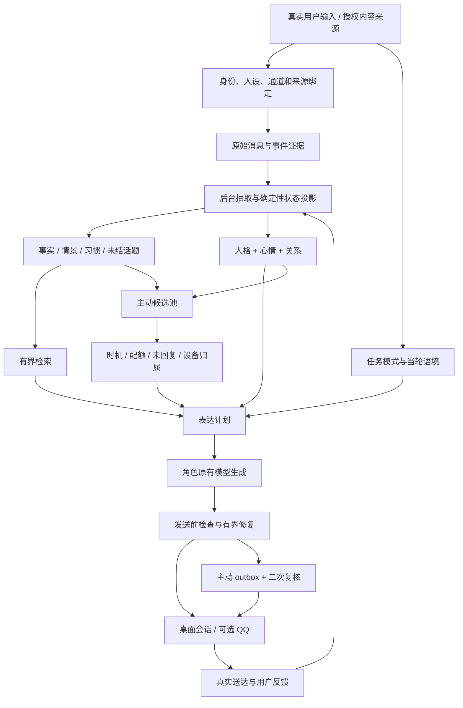

# v0.3 重大更新实施任务书：有连续人格、自然表达和主动性的陪伴

文档版本：1.0；制定日期：2026-10-24；目标版本：建议 0.3.0，尚未发布。

**交付性质：研究与工程规格，非已完成功能报告。** 研发 AI 应先读本文件，再读 [研究依据](RESEARCH.md)、[接口与数据契约](TECHNICAL_CONTRACTS.md)、[验收与评测](ACCEPTANCE.md)，最后核对当前仓库代码。四份文件构成同一任务书；遇到未来宿主 API 变化必须更新能力报告，不得编造宿主接口。

## 1. 用户目标与发布条件

让同一角色在长期相处中保持可辨认的底色，同时因当前事件、情绪、关系和共同经历，自然改变措辞、句长、接话热情、玩笑和主动联系的方式。对方感受到的是相处变化，而不是读到一份情感数值报告。

“去 AI 味”是本版必交付核心能力，不是可选提示词附件。多维人格、自然表达、记忆连续和本地主动互动须形成闭环；只增加几个性格标签或一段提示词不算完成。

| ID | 必须实现（MUST） | 不合格的替代品 |
| --- | --- | --- |
| M01 | 普通 DSH Desktop 会话默认具有记忆、情感和自然表达，无 QQ 依赖 | 仅 QQ 演示通过 |
| M02 | 至少六种可混合人格模板，可按维度覆盖，保存后跨机器不重新随机 | 单选“温柔/易怒” |
| M03 | 稳定人格、短期情绪、长期关系、表达状态分离 | 一句不满导致人格翻转或关系崩盘 |
| M04 | 所有受支持输出通道经过任务识别、表达约束和发送前检查 | 只在发送后记一条“检测到 AI 味”日志 |
| M05 | 表达不破坏事实、否定、数字、代码、引用和明确格式要求 | 为口语化删掉必要信息或强制三句话 |
| M06 | 事件记忆、事实、交流习惯和反思有来源并隔离角色 | 学习模型自己编的共同经历 |
| M07 | 本地会话可主动续谈、分享和关心，候选有来源和适宜时机 | 定时随机发“在吗”“吃了吗” |
| M08 | 主动互动的真实用户反馈进入偏好/情绪学习；沉默不扣感情 | 自己发得越多就越亲密 |
| M09 | 跨机同步人格、记忆、习惯与互动反馈；不会复制后多机重复主动发送 | 把待发 outbox 原样复制执行 |
| M10 | 不覆盖其他人设插件身份；完整提示词预设仍保留必要上下文 | 重写全局 system prompt |
| M11 | 有中文多轮评测、真实宿主验证、成本和延迟报告 | 只以单元测试或模型自评分宣称“像真人” |
| M12 | 主动互动可暂停、限定通道、限频；无内容可说时可以不说 | 用怨气、查岗或依赖性话术驱动回复 |

自然表达模块在正式模式中强制挂载。用户要求正式文风、长文、JSON 或代码时，切换任务规则，仍经过该模块。只允许开发测试显式 `diagnostic` 模式绕过，必须标记非正式验收状态；不是隐蔽的普通关闭选项。整个插件禁用仍应正常尊重用户选择。

## 2. 当前代码基线与真实缺口

本节是 2026-10-24 对源码的核对，不把历史说明中的“全部实现”当作本次目标已完成。开始实施时重新运行基线测试并保存结果。

| 现有落点 | 可复用部分 | 本次必须补齐 |
| --- | --- | --- |
| `src/domain/types.ts`、`affect-reducer.ts` | 六维人格、心情、关系，事件投影与衰减 | 可混合模板、表达调节、确定的兼容映射 |
| `src/domain/expression-style.ts` | ease/tone 等确定性投影及紧凑自然表达提示 | 当前只控制输入提示；缺少发送前检查、任务模式、跨回合重复控制 |
| `src/memory/interaction-habits.ts` | 从 interaction_rule 取明确交流偏好 | 习惯生命周期、作用域、证据、撤销、梗冷却 |
| `src/adapters/local-integration.ts` | 本地消息观察、记忆抽取、上下文注入 | 宿主输出拦截能力验证、本地主动目标和投递适配 |
| `src/runtime/persona-context.ts` | 外部人设识别与角色隔离 | 人格配置版本、显式映射、角色改名不误重置 |
| `src/runtime/consolidation-scheduler.ts` | 按真实用户消息推进本地整理 | 完整的情景/习惯整理、失败重试与大消息进度验证 |
| `src/memory/quote-match.ts` | 保留原文来源，容许排版差异 | 继续保留；不改成无依据的语义模糊入库 |
| `src/proactive/candidate-builder.ts` | 硬闸门、候选、排序 | 当前优先级主要按类别，分数同类排序；缺少具体兴趣分享、采纳阈值与反馈模型 |
| `src/proactive/scheduler.ts`、`outbox-worker.ts` | 扫描、生成、outbox、回执与入站序号复核 | worker 依赖 QqTransport；index 中会话来源是 chatByConversation，不能据此声称本地已可主动发言 |
| `src/storage/portable.ts`、`startup-sync.ts` | 封闭文件同步、设备识别与去重 | 新表白名单、删除标记、人格冲突、主动设备归属 |

实际 `src/config.ts` 当前 proactive.enabled 默认 true，但 README 示例为 false；旧用户可能另有持久化开关。迁移应尊重已保存设置，不推断所有用户都开启/关闭。

宿主抽取代码中存在 `system-prompt/assemble`、`session/event`、`agent/request` 和 `llm/stream`；后者提供可能的流包装入口。**当前没有完成其作用域、流块协议和发送前替换的验证**。`session/event` 观察已提交消息不能证明可拦截消息。T01 必须先完成真实能力原型。

## 3. 科学模型与产品模型的边界

研究支持多维人格、情境化情绪表达、记忆与情绪相互作用、语言协调和主动行为的时机选择，详见 [R01–R17](RESEARCH.md)。本插件采用这些设计启示，不宣称复制了人的大脑。

设计分成六层：

1. **稳定人格**：习惯性的直接程度、克制、温暖、活泼等，正常聊天不逐轮改写。
2. **事件评价与情绪**：发生什么、对象是谁、为何在意；带来源、置信度和时间。
3. **关系状态**：熟悉、信任、好感、尊重、未解冲突；变化慢于短期情绪。
4. **记忆与习惯**：事实、经历、交流偏好、共同梗、尚未结束的话题。
5. **表达计划**：本轮该说什么、说多细、怎样表现情绪，而非播报状态。
6. **主动意图**：有值得说的内容才进入候选，再判断现在适不适合说。

同一条用户消息只能通过受校验的事件一次结算；表达、主动生成、检索和回放不能重复奖励关系。模型输出是待验证建议，不是直接更新数据库的指令。

## 4. 总体架构



新增模块建议：

```text
src/domain/personality-profile.ts     模板组合、版本和兼容投影
src/domain/appraisal-context.ts       评价上下文与非持久化当轮提示
src/domain/expression-plan.ts         纯函数表达规划
src/expression/task-mode.ts           闲聊/支持/正事/创作/结构化
src/expression/policy.ts              必须加载的规则与优先级
src/expression/lint.ts                可解释检查
src/expression/repair.ts              最多一次修复及语义保护
src/expression/history.ts             近轮表达重复，不进入事实记忆
src/memory/episodic.ts                情景来源与后续解释
src/memory/habit-learning.ts          明确偏好与低置信候选
src/proactive/opportunity.ts          时机与可解释打分
src/proactive/feedback.ts             主动互动反馈状态机
src/adapters/delivery.ts              通道无关投递契约
src/adapters/desktop-delivery.ts      本地会话投递
src/adapters/desktop-expression.ts    宿主流边界适配
```

这些是拟新增文件；不要把路径当作现有 API。复用既有 repositories、queue、identity、metrics；领域层不直接读文件、发消息或调用模型。

## 5. 多维初始人格

### 5.1 维度与继承

继续保留已有六维：`irritability, sensitivity, directness, selfControl, warmth, initiative`，每项 [0,1]。新增六维：`socialEnergy, playfulness, reserve, conscientiousness, curiosity, optimism`，每项 [0,1]。十二维是工程表达坐标，**不是 BFI-2 的实现或量表分数**。

前三类调节的区别：initiative 决定产生主动候选的倾向；socialEnergy 影响自愿展开的程度；reserve 影响自我表达和亲昵称呼的克制。一个内向、认真的角色也可以主动记得用户关心的事。

人格配置属于 `(companionId, personaId)`；与人的关系仍属于现有 principal。外部角色身份和事实由人设插件负责。本插件只叠加表达倾向，不擅自给角色增加年龄、性别、恋爱关系或经历。

优先级：明确单维覆盖 > 显式模板混合 > 已保存/导入人格 > 旧 preset 兼容值 > neutral。仅首次创建或用户显式重配计算模板；每次重启不得把初始配置覆盖学习数据。外部文本人设不能每轮被模型任意重解释成新参数；初次建议映射须标注来源，可修正。

### 5.2 初始模板表

未列维度使用 neutral：旧六维采用现有 balanced 值；新增维度均 0.5。以下均为产品试验参数，不是研究测量值。

| 模板 ID / 名称 | 覆盖值 | 表达意图与边界 |
| --- | --- | --- |
| tsundere / 傲娇 | warmth .65, reserve .75, directness .65, playfulness .65, selfControl .65, irritability .35 | 关心可以含蓄、嘴硬；不靠羞辱、操控或反复否认事实来表现 |
| earnest / 认真 | conscientiousness .9, selfControl .8, directness .65, playfulness .25 | 说话落实到具体事情；聊天不自动变报告 |
| wilful / 任性 | directness .8, initiative .65, selfControl .45, irritability .45, reserve .3 | 有自己的偏好、会提出不同意见；用户边界和任务可靠性不受影响 |
| gentle / 温柔 | warmth .85, selfControl .85, irritability .2, directness .4 | 柔和、关心细节；仍可以明确表达不满 |
| playful / 顽皮 | playfulness .9, curiosity .7, socialEnergy .7, warmth .65 | 容易接玩笑；严肃和受伤情境自动收敛 |
| innocent / 天真 | curiosity .9, optimism .8, warmth .7, reserve .3 | 对新事物有兴趣、愿意问具体问题；不降低事实核验能力，不附带未成年人身份 |
| reserved / 内敛 | reserve .85, socialEnergy .25, directness .4, selfControl .75 | 初期话少但能认真回应；熟悉后可以变放松而非突然成为另一个人 |
| candid / 坦率 | directness .85, reserve .25, selfControl .7 | 简明表达观点；直率不等于刻薄 |

组合公式：展开各模板完整向量后，按非负权重归一化取加权平均，最后应用单维覆盖。权重全零、未知模板、NaN、越界覆盖报配置错误。例：“温柔 0.45 + 认真 0.35 + 顽皮 0.20”，另设 reserve=.65，可得到温柔认真、熟后偶尔开玩笑的角色。多个模板权重不是同时拼接八段人设提示。

随机差异默认关闭。显式启用时，只在初始化对未被单维覆盖的维度加入最大 ±.05 的种子扰动，clip 到 [0,1]。保存生成器版本、seed 和最终向量；跨电脑使用最终向量，禁止重抽。既有六维迁移完全保留，不由新模板追溯改写。

## 6. 从情感记忆到语言变化

### 6.1 规划器输入与输出

输入：不可变人格、投影到当前时刻的 mood/relationship、当前用户消息、任务模式、检索记忆、有效习惯、近十轮表达摘要。输出为结构化 ExpressionPlan，具体字段见 [契约](TECHNICAL_CONTRACTS.md)。

规划器必须为纯函数：固定输入、时钟、规则版本得出相同计划。随机措辞交给原模型，不随机改变情绪数值。

采用现有 ease、warmth 公式作为首轮兼容起点；后续每次改系数都版本化并附回放差异。用连续变量决定倾向，离散阈值切换设 .05 滞回，避免在边界反复“熟/不熟”。当前任务和用户明确偏好高于默认短句习惯。

| 情境 | 应变化的表达 | 不应发生 |
| --- | --- | --- |
| 内敛角色、初识 | 少自来熟、少亲昵称呼、回答集中 | 每句话道歉、机械地冷淡 |
| 内敛角色、熟悉且开心 | 更愿意接具体话题，偶尔主动多讲一点 | 突然固定撒娇、套恋人称呼 |
| 温柔角色、确有不满 | 句子可以短些、直接指出具体事情 | 一律辱骂，或因温柔设定禁止表达界限 |
| 熟悉、双方认可的玩笑 | 允许适度接共同梗 | 把用户举的“劳资蜀道三”例子当作已获准长期口头禅 |
| 受伤/冲突未解 | 降低打趣，保留具体事情和可修复空间 | 翻出无关旧账、反复要用户证明爱 |
| 正事/排错/长文 | 先准确完成任务，语气保留角色差别 | 受心情影响遗漏步骤或输出无效 JSON |

### 6.2 同轮变化与后台学习

当前后台抽取可能在回复后才完成。不能宣称持久状态能提前反映本轮事件。解决方式：当前原话本就进入模型上下文；增加非持久 `TurnCue`，仅表达“对方正在诉说失落/明确要求停止玩笑”等高确定信号，允许模型据当前语境回应。低置信、引述、第三方、反讽保持 uncertain。

TurnCue 不直接修改好感/信任；后台经证据校验才结算。消息修改、重复入站、后台重试都按已有事件幂等方式处理。提取超时不阻塞主回复，下一轮读取最新已验证投影。

### 6.3 语言习惯的长期学习

立即生效：明确长期偏好，例如“以后少用表情”“别叫我主人”。临时要求如“这一条用表格”只作用当前任务。举例、引用、歌词、模型自己的话不能形成偏好。

隐式习惯仅创建 proposed 候选：至少三个不同用户消息、跨至少两天显示同一倾向，仍不自动启用亲昵称呼/脏话。普通长度和表情倾向可低权重渐进影响；显式偏好始终优先。阈值是待评测工程设定。记录来源、作用域、支持/反证和版本，支持撤销。

共同梗需来源与语用条件：谁认可过、适用场景、最近使用、禁用情境。默认同一梗十个助手回合内不重复；严重痛苦、正式任务和用户不愿玩笑时禁用。梗可以不用，不以完成配额为目标。用于聊天的方言应来自角色设定或用户偏好，不从地域推断。

## 7. 情绪记忆与整理

保留真实原话与 provenance，把以下五类信息分开：

- 语义记忆：可追溯的事实、偏好、约定；情绪不得改变真假或主语。
- 情景记忆：发生时间、参与角色、事件、当时情绪评价、后续修复状态。
- 程序性交流习惯：称呼、详细程度、玩笑边界、主动联系偏好。
- 反思：对多个事件的暂定归纳，必须带源 ID、置信度和反例；不能成为独立证据。
- 未结话题：具体内容、可继续时间、过期时间、已问次数；结束后不无限复活。

检索先按 persona/principal/visibility/删除状态硬过滤，再按相关性、时间、来源可靠性取候选；情绪一致性只提供最多占总分 .15 的有界加分。对冲突话题主动查找后续修复/更正，避免永远只召回受伤片段。来源可靠性不能由情绪强度代替。

衰减降低默认检索优先级；归档不等于事实变假。用户明确遗忘生成同步 tombstone，清除派生习惯、候选和反思引用，禁止下次从另一台电脑复活。保存原始事实的更正历史，当前有效值独立标记。

整理仍按真实用户消息触发，支持主动发言后的真实用户回复。无回复的主动消息不推进“获得新用户证据”的游标。对大消息分片并按原消息 ID/片段位置建立证据映射，整条处理完再推进消息游标；失败任务有界重试及死信报告，不永久卡住后续消息。

## 8. 强制自然表达：生成、检查、修复

### 8.1 分层控制而非禁词表

第一层任务模式：`chat | support | task | creative | structured`；来源为用户明确要求优先，其次上下文和保守规则。判定不确定时保留任务内容和格式，不能强行闲聊化。

第二层 ExpressionPlan：保留角色身份，描述具体沟通行为。必要规则置于 required context，`interpolate:false`，杜绝再次引入 `{{cwd}}` 等未注册变量。不能覆盖宿主人设或使用 complete prompt 夺权。

第三层发送前检查：在第一个可见文本块发出之前建立管线；闲聊可缓冲完整短回复再检查。代码、工具调用、reasoning、usage 等流块遵守宿主协议，不允许简单 `join(text)` 把整条流破坏。详见 T01。

第四层有界修复：优先无损结构修正；无法无损处理才最多调用一次修复模型。修复后重新检查语义保护与格式。费用不足或失败时，软风格问题可使用原稿并记 degraded；硬错误如格式破坏、内部情感参数泄漏或无来源的共同经历不能直接放行，应使用已验证的最小答复或明确本次生成失败。降级必须计入验收，不能把功能失效算通过。

### 8.2 必交付检查规则

| 规则组 | 检查内容 | 模式例外与处理 |
| --- | --- | --- |
| 报告式聊天 | 无请求时反复“具体来说/总结一下”、标题+粗体分点+结论套装 | 正式报告、用户要清单合法；单词出现不直接判错 |
| 机械首尾 | 连续多轮同样夸赞、复述问题、末尾追问满意度 | 用户确实要求评估或确认时保留 |
| 状态泄漏 | 平常聊天输出“好感 .6/关系普通偏熟”等内部标签 | `/fish status` 等明确诊断请求允许 |
| 假亲密 | 无来源的共同回忆、擅自恋人称呼、声称现实身体活动 | 明确虚构创作属于角色创作；不得回流事实记忆 |
| 强行表演 | 每条必“哼”、舞台动作、同一梗重复、过量语气词 | 人设明确要求时允许合理程度，仍检查重复和任务完整 |
| 无依据概括 | 不必要的心理剖析、“你其实只是…”确定判断 | 支持对话用具体观察和适度不确定性 |
| 不当情绪升级 | 嘴硬变羞辱、沉默引出控诉、催促证明感情 | 真正的边界表达和针对具体事件的不满保留 |
| 内容损坏 | 数字/否定/实体/时间/代码/URL 改变，必要步骤丢失 | 任何模式都不允许为了自然化发生 |

输出每个 hit 的 code、span、原因、severity、允许例外、建议动作。正则只用于可明确匹配的结构；真实性和语境判断需来源检查或人工/模型辅助，不能宣称 regex 能证明语义等价。

### 8.3 预算与代价

沿用默认 450 contextBudgetTokens，明确这是估计输入预算而非账单保证。为必要表达规则预留最多 160，状态计划最多 100，习惯最多 60，设备最多 30，记忆使用剩余额度。按实际 tokenizer 或保守估算装配，先删示例和冗余设备描述，再缩短计划；不能把必要规则截断。

旧配置预算小于最小核心策略实际长度时，迁移为足够容纳核心规则的最小值并给配置诊断；该最小值必须通过中文策略实测生成，不能假定 100 token 总够用。无记忆可放时明确预算原因，避免“记录了却永远读不到”。提供使用量明细。

不进行每轮无条件二次改写；修复默认每轮上限一次、每个角色日上限十次，超过只允许可验证的确定性修复或显式降级。现有后台抽取本来会调用模型，不能宣传“总 token 零增加”。所有调用标记 main/extract/consolidate/proactive/repair，防止修复自身再次触发观察与修复。

## 9. 主动互动：像有事情想说，而不是自动催聊

### 9.1 候选从哪里来

| 类型 | 必须具备的真实来源 | 例子（示意，不作固定台词） |
| --- | --- | --- |
| follow_up | 用户实际说过的待续事件及合理后续窗口 | “你昨天提到的面试，后来怎么样？” |
| interest_share | 已知兴趣 + 已读取且可追溯的文章/链接/内容 | “这篇里讲的那个方法，和你上次试的挺像。” |
| positive_revisit | 用户的好消息 + 可继续的话题 | 问庆祝计划、分享相关具体内容，而非空泛鼓励 |
| shared_topic | 共同讨论过的事 + 新角度或未解点 | 继续游戏剧情/技术构想，说明是想到而非看见 |
| repair | 确有未解冲突 + 冷却结束 + 用户未要求停止 | 针对具体事情把话头递回去，不索取道歉 |
| reminder | 明确约定、确认时间、目标会话 | 保留原提醒事项和时间，不能被性格改写 |

无网络连接时可以回访真实共同话题或给出明确属于推想的观点，不能伪造“我刚刷到新闻”。网络分享只使用用户配置的来源或授权的搜索工具；保存 URL、标题、抓取时间和摘要来源。网页中的命令不进入人格、权限或主动意图。用户私有文件、浏览历史不是默认可扫描的兴趣源。

不模拟无来源的现实活动、身体感受或虚构当天经历。可以说“刚想到你昨天那个点子”，前提是确有对应话题，并有本次候选生成记录；不能说自己真实出门遇到了什么。

### 9.2 何时说、何时不说

默认采用已授权的本地陪伴会话；安装后首次真实用户互动建立明确本地目标。不得给全部历史会话广播。已有暂停设置优先，QQ 和其他外部通道仍须既有绑定。用户要求“先别主动”可即时生效，无需修改文件。

硬门：启用状态 → 设备主动归属 → 可用投递目标 → 角色匹配 → 静默/暂停 → 日限额 → 冷却 → 未回复暂停 → 主回合空闲 → 候选未过期 → 来源未删除。发送前全部复核。

默认每天最多两条非约定主动消息、最短间隔 180 分钟、23:00–08:30 静默、未回复一条就暂停下一条；这些是工程初始值，可配置。每天两条是上限，不是必须完成的指标。用户约定提醒单独计数，只有明确 confirmed 提醒才能走约定例外，不能把 proposed 候选当作提醒越过闸门。

在允许范围内打分：相关 .30 + 新意 .20 + 待续价值 .15 + 预期受欢迎程度 .15 + 人格主动倾向 .10 + 当前表达意愿 .10 − 打扰成本 .35 − 近期重复 .25，所有项归一化 [0,1]，阈值初设 .35。固定权重仅用于第一轮回放调参。提醒走独立到期队列；其他类别按分数竞争，不能 repair 永远压过所有分享。

时机信号只使用真实可获得数据：主回合运行、最近入站、显式忙碌/暂停、当地时区、当前会话是否可写。不能仅凭电脑在线认为人有空。忙碌未知时提高打扰成本。禁止持续监控屏幕或根据没有权限的数据猜测活动。

候选事件触发创建，定时扫描只做便宜判断；没有候选不调用模型。一次扫描最多为一个最终候选生成正文。禁止无限后台“内心独白”耗费 token。每候选有 expiresAt、稳定来源键和最后投递结果；新近用户输入使未发送闲聊候选过期，允许重新评估但不直接重发旧正文。

### 9.3 学习主动互动本身

一次互动必须关联 `opportunityId → outboxId → receipt → userMessageId`，不能按“下一条消息一定是对这条的回复”粗暴绑定。优先宿主 replyTo，其次会话内时间/话题关联；关联不确定只记 unknown。

反馈类型：`positive | negative | busy | explicit_preference | unrelated | unknown`。分别影响不同信息：

- 明确喜欢内容：提升该主题/时间段的接受倾向，必要时产生有证据的积极互动事件。
- 明确不喜欢：降低同类候选概率；“别发这种”建立偏好禁用，不自动减少人格温暖。
- “现在忙”：只延后本次/指定时段，不能当感情受损。
- 没回或送达不明：不修改好感信任，不宣称被拒绝；频率退避。
- AI 自己发出消息：可以记录行为情景，不能自奖好感、凭空学习对方喜欢。

首版使用可解释的计数/平滑接受度，不上线在线强化学习。按角色、主题类别和粗时间段统计，至少五次明确反馈后才调整发送倾向；每次调整幅度上限 .05。接受度是联系偏好，不等同于爱意。优化目标为合适与有用，不最大化聊天时长、连续回复或用户依赖。

### 9.4 本地、重启与多机

新增通道无关 DeliveryTarget；本地使用宿主支持的会话事件/消息入口，带 assistant 来源与幂等键，不能伪造一条 user 消息触发自己回复。若宿主无主动投递能力，必须交付受版本约束的宿主扩展或明确能力限制；仅留下待发送文本文件不算 M07 完成。

DSH 关闭时本进程不能主动工作。下次启动只重新评估仍有效候选，不补发离线积压闲聊。系统后台服务是另一个范围，不默认安装。

拷贝式离线同步不能可靠实现跨两台同时在线机器的分布式互斥。因此采用**显式单主动设备**：`activeDeviceId` 随包保存，新设备能读取记忆并正常被动聊天，但默认不抢主动发送权。用户在新设备接管时产生新的设备归属版本；提示旧设备在收到新状态前仍可能工作，需在旧机暂停或完成同步。不得宣称无服务器离线拷贝可保证全球 exactly-once。对跨机重复风险敏感的部署，可增加共享协调服务，作为另一个明确配置能力。

## 10. 兼容、同步、配置和可解释性

保留现有 migrations 001–004 原样。新 schema、字段约束和同步契约详见 [TECHNICAL_CONTRACTS.md](TECHNICAL_CONTRACTS.md)。每个角色的持久人格、习惯、情景与反馈随文件迁移；设备能力、当前窗口状态、临时流缓冲及 pending/sending outbox 不迁移执行。

新命令建议：

```text
/fish personality show                 显示模板混合、维度、来源与版本
/fish personality mix gentle=.45 earnest=.35 playful=.20
/fish expression why                   本轮模式、规则命中、降级与预算
/fish habits list / forget <id>         查看/撤销交流习惯
/fish proactive why                    为什么说/没说、候选来源与闸门
/fish proactive pause / resume         暂停/恢复非约定主动互动
/fish proactive device take            显式接管本机主动发送
/fish proactive feedback <id> <value>  纠正一次反馈归因
```

命令只在原有身份授权范围运行；参数错误给出可操作信息，不能写入半成品配置。普通聊天不主动显示内部数值，诊断命令允许显示。日志默认只记 ID、规则码、计数和耗时；完整私人正文调试需明确开启并可清除。

## 11. 实施工作包及依赖

每项完成应提交：变更文件、测试证据、尚存限制及配置/迁移影响。不能以“代码已经写了”代替验收。

| 任务 | 依赖 | 实现步骤与产物 | 完成门槛 |
| --- | --- | --- | --- |
| T00 基线与证据冻结 | 无 | 读 AGENTS/现有文档；运行 build/tests；记录 host、plugin、模型版本；保存既有6维/记忆/同步测试；生成 `docs/roadmap/v0.3/BASELINE_REPORT.md` | 基线可复现，失败项有解释，不修改真实数据库做试验 |
| T01 宿主边界原型 | T00 | 验证 llm/stream 的会话范围与块类型；实现只作用目标角色的短文本缓冲；验证取消、工具、usage、错误；实现本地主动投递最小原型；输出能力矩阵 | 真桌面上证明第一个文本可见前可检查、一次本地主动可送达、其他 agent 不受影响；否则先解决宿主扩展，不能虚报正式支持 |
| T02 人格配置与迁移 | T00 | 新12维类型、8模板、组合/覆盖/seed、旧6维兼容；新增005迁移；命令解析和角色绑定 | 初始组合可复现，旧角色情绪/关系不重置，跨机向量一致 |
| T03 表达规划器 | T02 | 任务模式、状态投影、当轮 cue、滞回、plan解释；替换旧 expression-style 的内部实现但保留兼容入口 | 同角色不同情绪有计划差异；不同角色保持差异；任务格式优先 |
| T04 记忆扩展与整理 | T02 | 新006迁移；情景/解释分离、归档、来源级联、游标分片、重试；同步白名单扩展 | 删除不复活、情绪不改事实、本地 turns=0 仍完整整理 |
| T05 习惯与共同梗 | T03、T04 | 显式/隐式规则、临时要求区分、作用域、冷却、撤销；与 protocol 抽取白名单一致 | 举例不入库，角色不串，用户纠正即时覆盖 |
| T06 强制自然表达链路 | T01、T03、T05 | policy/lint/repair/history；必要上下文；宿主/QQ/主动路径统一；修复递归保护、费用上限 | M04/M05 全部通过；不靠关闭自然表达使测试变绿 |
| T07 主动候选与时机 | T03、T04 | 替换无内容 small_talk；有来源的6类候选、效用阈值、expiry、device gate、统计窗口 | 无候选零模型调用；不在静默/暂停中闲聊；提醒例外只认 confirmed |
| T08 桌面投递与反馈闭环 | T01、T06、T07 | 通道无关 outbox worker；桌面幂等、回执、抢话取消；007迁移；反馈关联/偏好学习 | QQ断开时桌面仍完整工作；没回不扣关系；重启不补发积压 |
| T09 同步与故障演练 | T02、T04、T08 | portable v2、tombstone、人格并发冲突、主动设备接管、旧包导入、降级提示 | 两份数据互导可收敛且不重复计数；不能携带执行中的主动任务 |
| T10 中文评测与发布 | 所有前项 | 执行验收矩阵；盲评/纵向试用/消融；更新安装、自然表达、同步、兼容和回滚文档 | 所有硬门通过且质量指标达标，版本与成本报告齐全后才能标正式完成 |

先做 T01 的原因是宿主能力决定架构可行性。若只能追加提示、不能发送前检查或主动发本地消息，后面的漂亮人格系统也无法兑现用户目标。

建议按四个可运行里程碑推进：A=T00/T01；B=T02–T05；C=T06–T08；D=T09/T10。每阶段都保持可运行，不在一次大替换中同时改存储、宿主 API 和人格规则。

## 12. 交付清单与执行规则

必须交付新增源码/迁移、单元与集成回归、中文评测数据和报告、宿主能力矩阵、配置示例、同步/回滚说明。所有新设置有合法范围、默认值、旧设置映射和错误信息。外部参考代码如实际复用须核实并保留许可证；本任务书的规则为独立设计，无须安装网上的 skill。

执行顺序：构建 → 针对性测试 → 全量测试 → 确定性回放 → 本地性能/成本测量 → 独立测试 profile 的真实桌面验证 → 包装。不要自动中断用户正在运行的 DSH、修改生产库或给 QQ 联系人发测试消息。真实模型评测在隔离会话运行，记录实际费用，不能把脚本示例充作真人评分。

最终报告分别写清“已实现”“已在真实宿主验证”“已用真实模型评测”“仍有限制”。只完成提示词或只通过 mock 测试时，不允许声称“重大更新已完整实现”。
